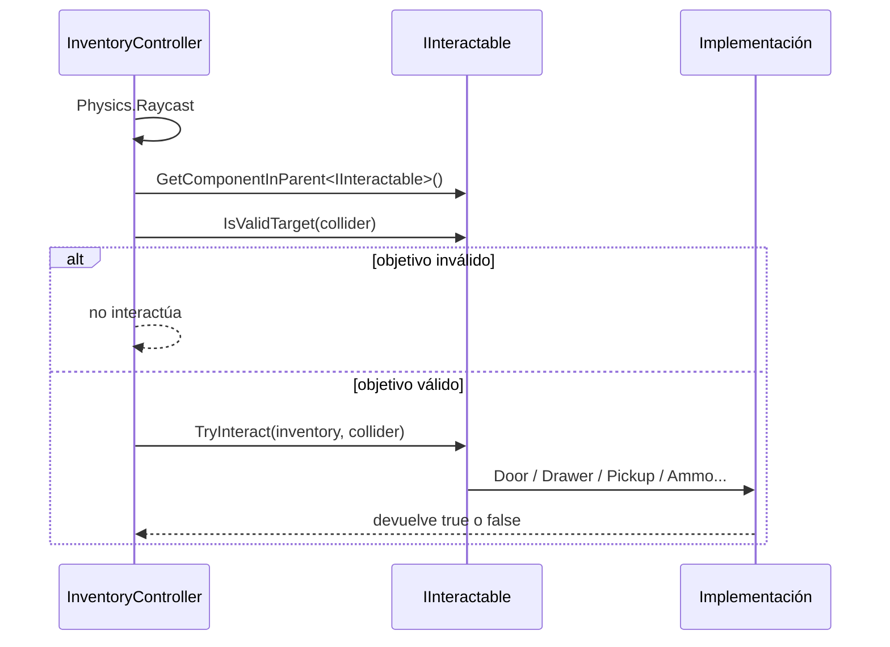
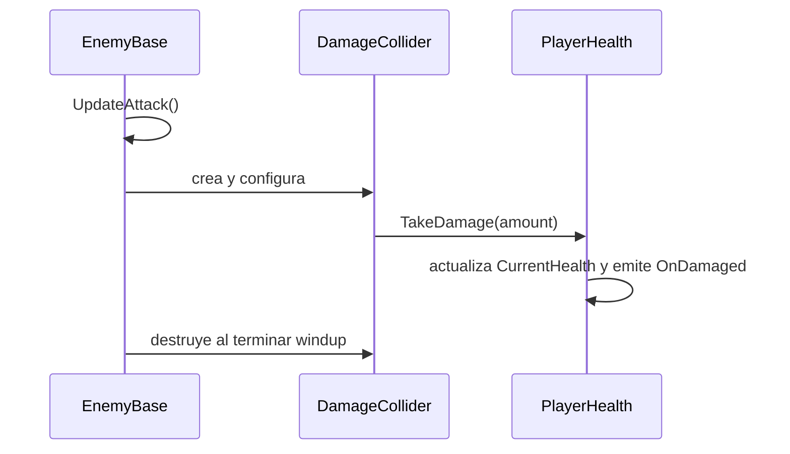
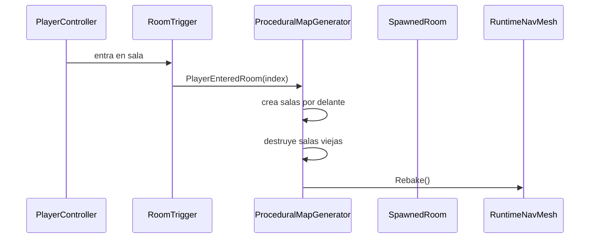
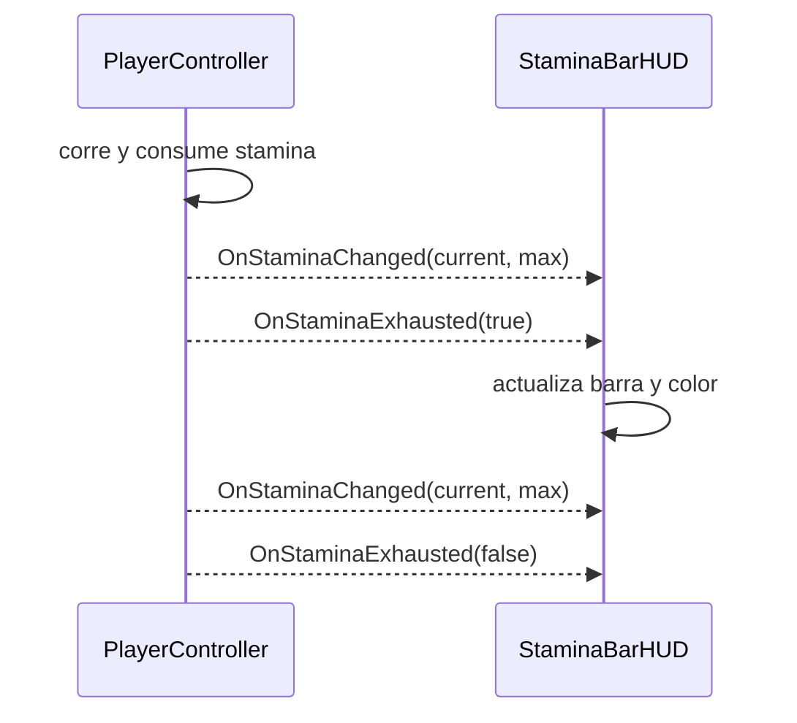

# Prisa Controlada — UML y arquitectura TP2

> **Fuente de verdad:** el código actual del proyecto.<br>
> **UML editable:** [`PrisaControlada_UML_TP2.drawio`](../PrisaControlada_UML_TP2.drawio)<br>
> **Integrantes:** Matías Morilla, Ian Rosenberg, Agustín Labarque y Francisco Larrondo.

Este documento reemplaza la descripción anterior, que describía la primera versión de `EnemyBase` con `CharacterController` y no incluía la arquitectura procedural, la interfaz de interacción ni los extras de C# implementados durante el TP2.

---

## 1. Cómo está organizado el UML TP2

El archivo `PrisaControlada_UML_TP2.drawio` contiene cuatro pestañas:

| Pestaña | Objetivo | Evidencia principal |
|---|---|---|
| **01 - Obligatorios y extras** | Vista compacta para la defensa | `EnemyBase`, `IInteractable`, `WeightedTable<T>`, structs, enums, diccionario y extensión |
| **02 - Player e interacciones** | Mostrar polimorfismo, herencia y eventos | `IInteractable` y sus nueve implementadores directos; inventario y HUD |
| **03 - Enemigos y ragdoll** | Mostrar clase abstracta, herencia y composición | `EnemyBase`, cuatro especializaciones, `DamageCollider` y ragdoll |
| **04 - Mapa procedural** | Mostrar la arquitectura que realmente quedó implementada | Streaming de salas, tablas ponderadas, loot, puzzle y NavMesh runtime |

### Regla de sincronización

Todos los tipos mostrados en el UML existen en el proyecto. Las clases de la propuesta original que fueron superadas por la arquitectura implementada —por ejemplo, `Blit`, `BlitScheduler`, `LevelManager`, `RoomInstance` y `ProceduralGenerator`— no se presentan como clases vigentes.

La equivalencia TP1 → TP2 se explica de esta manera:

| Diseño de TP1 | Implementación vigente en TP2 |
|---|---|
| Secuencia de “blits” | Ventana de streaming de `ProceduralMapGenerator` |
| `RoomInstance` | Clase privada anidada `SpawnedRoom` |
| `RoomPrefab` | `RoomDefinition` como definición serializada del prefab |
| `LevelManager` | `ProceduralMapGenerator` + `RuntimeNavMesh` |
| `LootTable` | `LootSpawner` + `WeightedTable<LootEntry>` |
| `SpawnPointConfig` | `EnemyLootSpawner` + `RoomDirector` |
| `RoomConnection` | Anclas `Anchor_In` / `Anchor_Out_N` |

---

## 2. Vista general de la arquitectura

```mermaid
flowchart LR
    subgraph Player[Player]
        PC[PlayerController]
        PH[PlayerHealth]
        INV[InventoryController]
        HUD[StaminaBarHUD]
        PROX[ProximityHighlighter]
    end

    subgraph Interactions[Interacciones]
        II[IInteractable]
        PICK[PickupItem]
        DOOR[DoorController]
        DRAW[DrawerController]
        AMMO[AmmoPickup y otros]
    end

    subgraph Enemies[Enemigos]
        EB[EnemyBase abstract]
        Z[ZombieEnemy]
        R[RunnerEnemy]
        B[BlindEnemy]
        N[NemesisEnemy]
        DC[DamageCollider]
    end

    subgraph Map[Mapa procedural]
        PMG[ProceduralMapGenerator]
        SR[SpawnedRoom]
        RD[RoomDefinition]
        RT[RoomTrigger]
        NAV[RuntimeNavMesh]
        WT[WeightedTable<T>]
    end

    PC --> PH
    PC -- OnNoiseMade --> Z
    PC -- OnNoiseMade --> B
    PC -- OnStaminaChanged --> HUD
    INV --> II
    PROX --> II
    II <|.. PICK
    II <|.. DOOR
    II <|.. DRAW
    II <|.. AMMO
    EB <|-- Z
    EB <|-- R
    EB <|-- B
    EB <|-- N
    EB *-- DC
    DC --> PH
    PMG *-- SR
    PMG --> RD
    PMG --> RT
    PMG --> NAV
    PMG --> WT
```

---

## 3. Los cinco conceptos obligatorios

### 3.1 Herencia

**Evidencia principal:** `Assets/Scripts/Enemies/EnemyBase.cs`.

```text
EnemyBase
├── ZombieEnemy
├── RunnerEnemy
├── BlindEnemy
└── NemesisEnemy
```

La herencia no es ornamental: la clase base define stats, navegación, percepción, daño, ataque y muerte; cada subclase cambia comportamiento real.

Otros ejemplos válidos:

- `PickupItem → WeaponPickup → ShotgunPickup`.
- `DoorController → CodeDoor`.
- `DoorController → LockedDoor`.

**Qué explicar:** la jerarquía permite reutilizar el contrato común del enemigo sin convertir la subclase en una simple etiqueta.

---

### 3.2 Composición

Hay tres composiciones inequívocas:

1. **`EnemyBase → DamageCollider`**<br>
   `EnemyBase` crea un `GameObject` hijo durante el ataque, le agrega `DamageCollider`, lo configura y lo destruye al terminar. La parte no puede existir fuera del ciclo de ataque del todo.

2. **`Ragdoll → RagdollComponent`**<br>
   `Ragdoll` contiene la lista de componentes por hueso y controla sus `Rigidbody` y `Collider`.

3. **`ProceduralMapGenerator → SpawnedRoom`**<br>
   El generador mantiene la lista de salas vivas, las crea, las conecta y las destruye cuando salen de la ventana de streaming.

**Qué explicar:** el rombo relleno se usa donde el todo controla creación y destruction de la parte, no sólo porque conserve una referencia.

---

### 3.3 Clase abstracta

**Archivo:** `Assets/Scripts/Enemies/EnemyBase.cs`.

`EnemyBase` es `abstract` y define un método abstracto junto con hooks virtuales para las operaciones comunes:

- estadísticas (`ApplyDefaultStats` es abstracto y cada enemigo debe implementarlo);
- inicialización y actualización;
- daño y muerte;
- cancelación de ataque.

No se la marca abstracta únicamente por estilo: sus cuatro derivadas tienen comportamiento realmente diferente:

- `ZombieEnemy`: persecución, búsqueda y reacción a impactos.
- `RunnerEnemy`: estado de vigilancia y persecución rápida.
- `BlindEnemy`: caza por ruido y memoria de `NoiseStamp`.
- `NemesisEnemy`: persecución persistente e inmortal.

**Qué explicar:** `EnemyBase` representa “un enemigo con capacidad de atacar y morir”; cada subclase define cómo se comporta ese enemigo.

---

### 3.4 Interfaz

**Archivo:** `Assets/Scripts/Items/IInteractable.cs`.

```csharp
public interface IInteractable
{
    bool IsValidTarget(Collider hitCollider);
    bool IsGrabbable { get; }
    bool TryInteract(InventoryController inventory, Collider hitCollider);
}
```

Implementadores directos:

- `PickupItem`;
- `DoorController`;
- `DrawerController`;
- `NoteItem`;
- `AudioTrigger`;
- `AmmoPickup`;
- `ShotgunAmmoPickup`;
- `GlockAmmoPickup`;
- `GlockMagazinePickup`.

`WeaponPickup` y `ShotgunPickup` heredan la realización de `PickupItem`.

Consumidores reales:

- `InventoryController` busca `IInteractable`, valida el collider y llama `TryInteract`.
- `InteractionCrosshair` consulta `IsValidTarget`.
- `ProximityHighlighter` usa `IsGrabbable` y `IsValidTarget` sin mantener una cadena de tipos.

**Qué explicar:** la interfaz permite tratar igual objetos sin herencia común y elimina la antigua cadena de `if` por tipo concreto.

---

### 3.5 Encapsulamiento

Ejemplos claros:

- `PlayerHealth.CurrentHealth { get; private set; }`.
- `PickupItem.IsHeld { get; private set; }`.
- `LootSpawner.LastSpawned { get; private set; }`.
- `InventoryController.HeldItem => _heldItem`.
- `PuzzleCodeController.DoorCode { get; }`.
- `Rig.Pelvis { get; private set; }`.
- `NemesisEnemy.Progress { get; set; }`.

Los campos serializados o de estado permanecen privados y las propiedades deciden qué puede leerse o modificarse.

**Qué explicar:** el getter expone información útil; el `private set` impide que otro sistema rompa la transición de estado.

---

## 4. Los siete extras

### 4.1 Genéricos

**Archivo:** `Assets/Scripts/Core/WeightedTable.cs`.

```csharp
public class WeightedTable<T>
{
    public void Add(T item, float weight);
    public T Roll();
    public void Clear();
}
```

Uso real:

| Consumidor | Tipo instantiated |
|---|---|
| `LootSpawner` | `WeightedTable<LootEntry>` |
| `EnemyLootSpawner` | `WeightedTable<EnemyEntry>` |
| `ProceduralMapGenerator` | `WeightedTable<RoomDefinition>` |

La clase conserva `T`; no castea a `object` ni vuelve a tipar el resultado dentro de la implementación.

**Qué explicar:** una sola algoritmo de sorteo ponderado sirve para tres dominios distintos.

---

### 4.2 Eventos y delegados

Los eventos y delegados se defienden juntos, como un único punto de la rúbrica.

| Productor | Evento / delegado | Consumidor |
|---|---|---|
| `PlayerController` | `OnNoiseMade : Action<float>` | `ZombieEnemy`, `BlindEnemy` |
| `PlayerController` | `OnStaminaChanged : StaminaChangedHandler` | `StaminaBarHUD` |
| `PlayerController` | `OnStaminaExhausted : StaminaExhaustedHandler` | `StaminaBarHUD` |
| `PlayerHealth` | `OnDamaged`, `OnDied`, `OnHealed` | HUD, audio, bodycam y secuencia de muerte |
| `InventoryController` | `InventoryChanged : Action` | `InventoryHUD`, `AudioTensionAgent` |
| `DoorController` | `NavigationStateChanged : Action<DoorController>` | `EnemyBase` |

`StaminaChangedHandler` y `StaminaExhaustedHandler` son delegates nombrados dentro de `PlayerController`.

**Qué explicar:** el productor no conoce al consumidor; publica el cambio y quien necesite reaccionar se suscribe y luego se da de baja.

---

### 4.3 Structs

1. **`NoiseStamp`** — `Assets/Scripts/Enemies/NoiseStamp.cs`.

```csharp
public struct NoiseStamp
{
    public float time;
    public float level;
    public Vector3 position;
}
```

Se usa en `ZombieEnemy` y `BlindEnemy` como memoria de ruido. Antes estaba duplicado dentro de ambas clases; durante TP2 se consolidó en un tipo compartido.

2. **`CodeEntry`** — tipo privado anidado en `PuzzleCodeController`.

```csharp
[Serializable]
private struct CodeEntry
{
    public string id;
    public string code;
}
```

Cada fila de la tabla del puzzle es un valor serializable con la pista visible y el código real.

**Qué explicar:** son estructuras de valor pequeñas, no clases con estado global.

---

### 4.4 Diccionarios

**Archivo:** `Assets/Scripts/Player/ProximityHighlighter.cs`.

```csharp
Dictionary<GameObject, PickupArrow> _arrowsByPickup;
```

La clave es la identidad lógica del pickup, no una cantidad ni un índice de aparición. El valor permite reutilizar la flecha asociada.

Otro ejemplo:

```csharp
Dictionary<Transform, Vector3> _boneOffsets;
```

en `ZombieEnemy`, para asociar offsets de impacto con huesos concretos.

**Qué explicar:** `Dictionary<K,V>` permite recuperar una relación por clave estable en tiempo promedio constante.

---

### 4.5 Enums

Ejemplos vigentes:

- `EnemyType`: `Zombie`, `Runner`, `Blind`, `Nemesis`.
- `RoomType`: `Hub`, `Pasillo`, `Combate`, `Loot`, `Puzzle`, `Historia`.
- `ZombieState`: `Idle`, `Chase`, `Search`.
- `RunnerState`: `Idle`, `Watch`, `Chase`.
- `BlindState`: `Wander`, `Stalk`, `Chase`.
- `PickupWeaponKind`: `Revolver`, `Shotgun`.
- `BodyParts`: `Head`, `CenterMass`, `Arm`, `Leg`.

**Qué explicar:** el enum da significado al dominio y evita números mágicos.

---

### 4.6 Extensiones de clases

**Archivo:** `Assets/Scripts/Extensions/TransformExtensions.cs`.

```csharp
public static Transform FindRecursive(
    this Transform transform,
    string name,
    bool includeInactive = false)
```

Se consume realmente en `Assets/Scripts/Ragdoll/Rig.cs` para encontrar huesos anidados.

**Qué explicar:** `this` permite usar `transform.FindRecursive(...)` sin modificar `Transform` ni agregar una jerarquía artificial.

---

### 4.7 Getters y setters

Además de los ejemplos de encapsulamiento, el proyecto usa:

- `get; private set;` para estado controlado;
- getters calculados como `HorizontalSpeed`, `CurrentCost` y `Remaining`;
- un setter público real en `NemesisEnemy.Progress`.

**Qué explicar:** las propiedades pueden validar, transformar o limitar el acceso al campo subyacente.

---

## 5. Flujos principales defendibles

### 5.1 Interacción con un objeto



### 5.2 Ataque de un enemigo



### 5.3 Streaming del mapa



### 5.4 Stamina reactiva



---

## 6. Paquetes y responsabilidades

| Paquete | Responsabilidad | Tipos representativos |
|---|---|---|
| `Assets/Scripts/Player` | Jugador, cámara, salud, inventario, HUD, feedback | `PlayerController`, `PlayerHealth`, `InventoryController`, `StaminaBarHUD`, `ProximityHighlighter` |
| `Assets/Scripts/Items` | Pickups, munición, puertas, cajones e interacciones | `IInteractable`, `PickupItem`, `DoorController`, `LootSpawner` |
| `Assets/Scripts/Enemies` | IA, percepción, daño, spawn y presupuesto de salas | `EnemyBase`, cuatro enemigos, `DamageCollider`, `RoomDirector` |
| `Assets/Scripts/Map` | Streaming de salas, anclas, puzzle y tipos de sala | `ProceduralMapGenerator`, `RoomDefinition`, `RoomTrigger`, `PuzzleCodeController` |
| `Assets/Scripts/Core` | Utilidades runtime y genéricos | `WeightedTable<T>`, `RuntimeNavMesh` |
| `Assets/Scripts/Extensions` | Extensiones de tipos del framework | `TransformExtensions` |
| `Assets/Scripts/Ragdoll` | Construcción y control del ragdoll | `Ragdoll`, `RagdollComponent`, `RagdollCreator`, `Rig` |
| `Assets/Scripts/Menu` | Menús, libro y flujo de interfaz | `MainMenuController`, `BookMenuController` |

---

## 7. Mapa de autoría registrado en el código

Cada clase o bloque importante de TP2 incluye un comentario `//TP2 - Nombre Apellido`.

| Integrante | Áreas |
|---|---|
| **Matías Morilla** | `Core`, mapa procedural, ragdoll, extensiones y herramientas de Editor |
| **Ian Rosenberg** | Player, salud, stamina, HUD, VHS y postprocesado |
| **Agustín Labarque** | Enemigos, daño, spawners, presupuesto de sala y puzzle |
| **Francisco Larrondo** | Items, pickups, puertas, inventario, armas y menú |

> Para la defensa, cada integrante debe abrir y explicar su área. El comentario sirve como trazabilidad, pero no reemplaza una explicación propia.

---

## 8. Verificación final

Antes de presentar:

- [ ] `PrisaControlada_UML_TP2.drawio` abre en diagrams.net.
- [ ] La compilación de Unity no muestra errores.
- [ ] `Shift+F12` encuentra cada ejemplo mostrado.
- [ ] La escena `Prototype` inicia y permite probar inventario, puertas, munición y mapa procedural.
- [ ] La demo final funciona con build o Play Mode.
- [ ] Cada integrante puede explicar un obligatorio y al menos un extra en aproximadamente 30 segundos.
- [ ] No se presenta como vigente ninguna clase inexistente.
- [ ] Si se decide incorporar los power-ups anunciados en TP1, se implementan **antes** de volver a dibujar o defender esa parte del UML.

---

## 9. Estado de los power-ups del TP1

El TP1 también anunciaba `MeleeWeapon`, `TapeItem`, `KnifePowerUp`, `ShieldPowerUp`, `HammerPowerUp`, `ChainsawPowerUp`, `PowerUpManager` y `TapeAttachment`. Esos tipos todavía no existen en el código actual.

Por esa razón **no aparecen en el UML TP2 vigente**. Hay dos caminos defendibles:

1. incorporarlos como functionality real antes de la entrega final, o
2. explicar formalmente que el alcance TP2 se concentró en la arquitectura procedural, la refactorización de interacciones y los extras de C#.

La primera opción ofrece la máxima continuidad con el PDF de TP1; la segunda evita mostrar clases que no estén implementadas.
