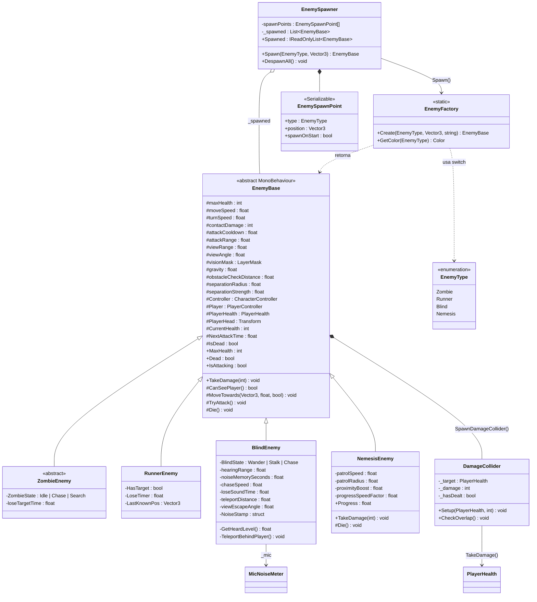
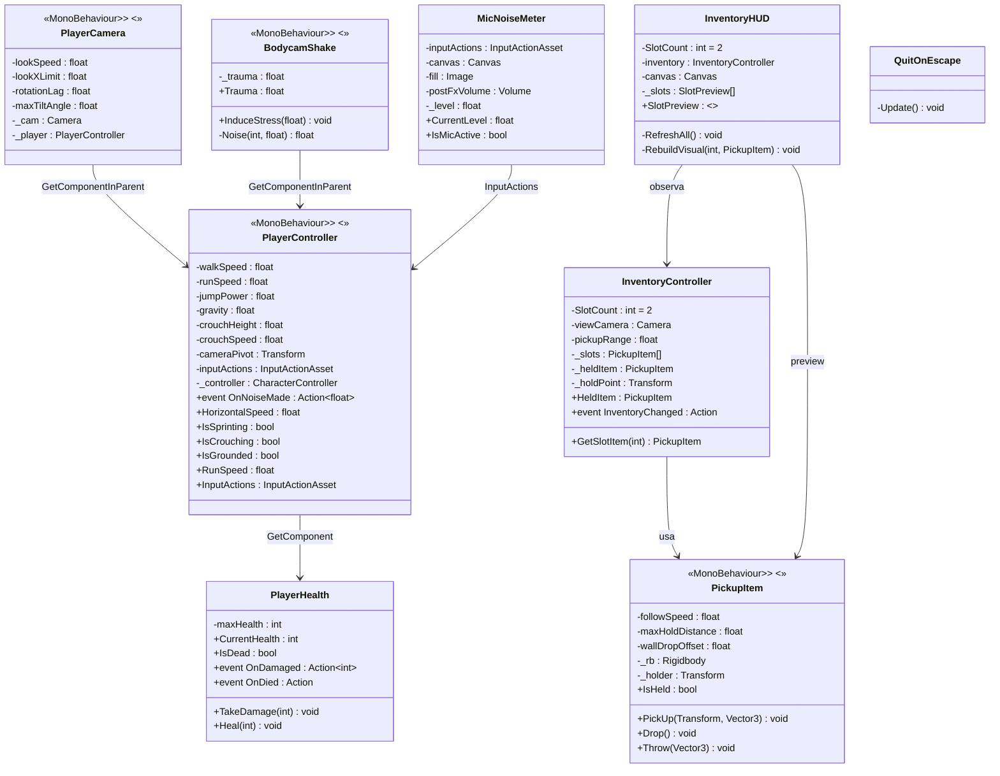
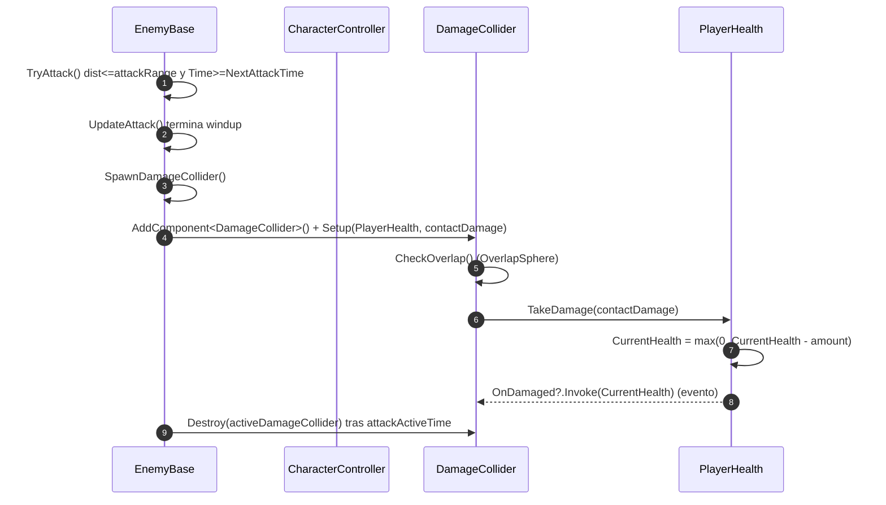
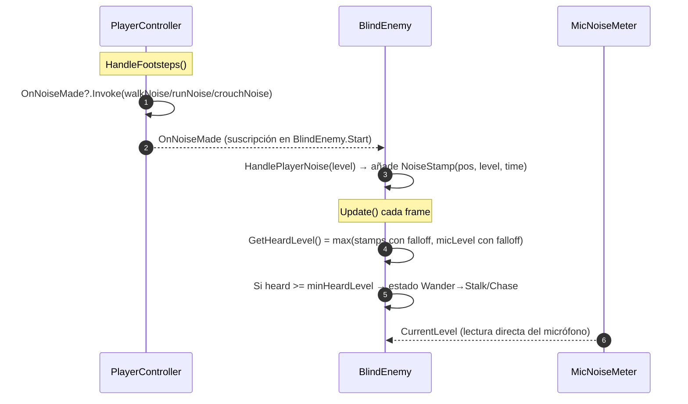
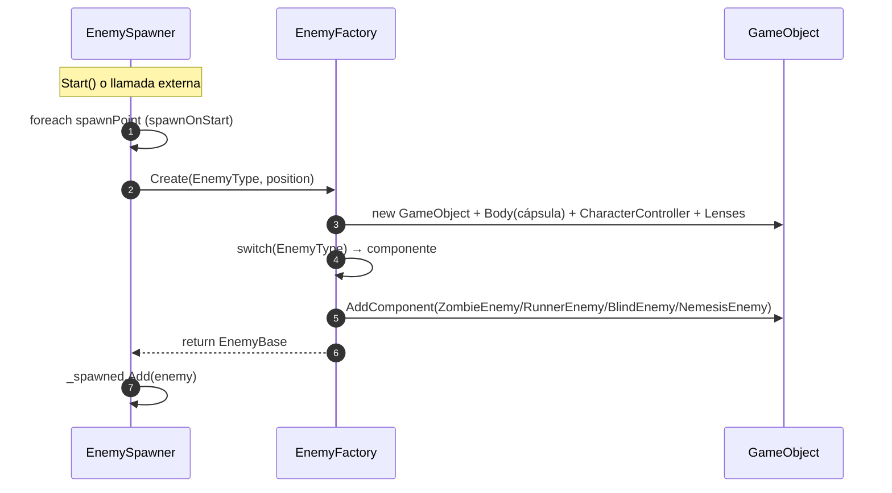
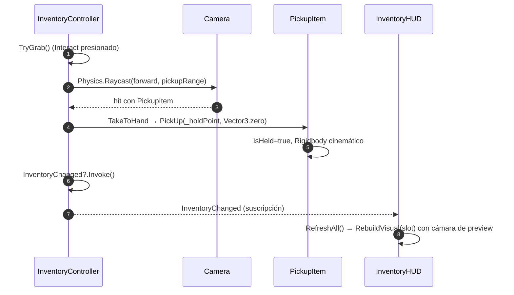
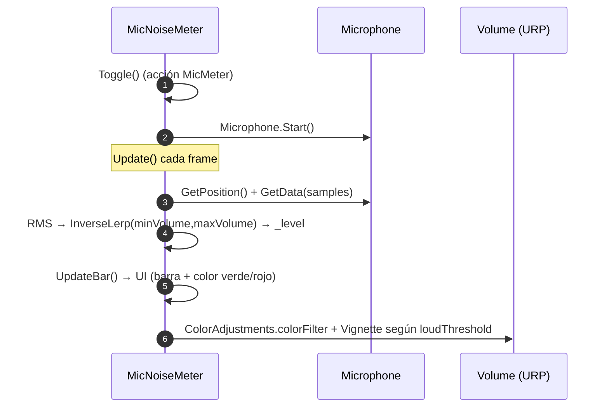

# PrisaControlada — Documentación UML del Código

Documento generado a partir del código real del proyecto. Incluye:

1. Resumen del sistema y paquetes
2. Diagramas de clases UML (Mermaid, renderizables en GitHub / VS Code)
3. Explicación detallada de cada clase con referencias `archivo:línea`
4. Diagramas de secuencia de los flujos clave
5. Reglas de funcionamiento (contratos entre clases)

---

## 1. Resumen del sistema

**PrisaControlada** es un juego de terror en primera persona (estilo "found footage" con bodycam) hecho en **Unity (URP, Input System)**.

El proyecto se organiza en 5 paquetes/namespaces:

| Paquete | Namespace | Responsabilidad |
|---|---|---|
| `Assets/Scripts/Enemies` | `PrisaControlada.Enemies` | IA de enemigos, fábrica, spawner y collider de daño |
| `Assets/Scripts/Player` | `PrisaControlada.Player` | Movimiento, cámara, vida, ruido/micrófono, inventario, HUD, temblor de bodycam |
| `Assets/Scripts/Items` | `PrisaControlada.Items` | Objetos agarrables/lanzables |
| `Assets/Scripts/Core` | `PrisaControlada.Core` | Utilidades (salir con ESC) |
| `Assets/Scripts/Editor` | `PrisaControlada.Editor` | Herramientas de edición (montaje de escena, spawn de pruebas) |

**Idea base de gameplay:**

- El jugador se mueve, agacha, corre y genera **ruido** (pisadas) que se emite vía el evento `OnNoiseMade` de `PlayerController`.
- Los enemigos **perciben** al jugador por visión (`CanSeePlayer`) o por ruido (el `BlindEnemy` "oye" el micrófono y los pasos).
- El jugador tiene **vida** (`PlayerHealth`), **inventario de 2 slots** (`InventoryController`) y un **medidor de micrófono** (`MicNoiseMeter`) que activa post-procesado VHS.
- Los enemigos se crean de forma procedural con `EnemyFactory` (cápsula + collider + script) y se gestionan con `EnemySpawner`.

---

## 2. Diagrama de clases general

```mermaid
classDiagram
    direction LR

    namespace Enemies {
        class EnemyType {
            <<enumeration>>
            Zombie
            Runner
            Blind
            Nemesis
        }

        class EnemyBase {
            <<abstract>>
            #int maxHealth
            #float moveSpeed
            #float turnSpeed
            #int contactDamage
            #float attackCooldown
            #float attackRange
            #float viewRange
            #float viewAngle
            #LayerMask visionMask
            #float gravity
            #float obstacleCheckDistance
            #float separationRadius
            #float separationStrength
            #CharacterController Controller
            #PlayerController Player
            #PlayerHealth PlayerHealth
            #Transform PlayerHead
            #int CurrentHealth
            #float NextAttackTime
            #bool IsDead
            -bool _isAttacking
            -float _attackTimer
            -GameObject _activeDamageCollider
            +int MaxHealth
            +bool Dead
            +bool IsAttacking
            #Awake() void
            #Start() void
            #Update() void
            #LateUpdate() void
            +TakeDamage(int amount) void
            #Die() void
            #bool CanSeePlayer()
            #MoveTowards(Vector3 target, float speed, bool faceTarget) void
            -Vector3 SteerAround(Vector3 dir)
            -bool IsBlocked(Vector3 origin, Vector3 dir, float distance)
            -Vector3 Separate(Vector3 dir)
            #TryAttack() void
            -UpdateAttack() void
            -SpawnDamageCollider() void
            #bool PlayerIsLookingAt(Vector3 worldPos, float maxAngle)
        }

        class ZombieEnemy {
            <<EnemyBase>>
            -ZombieState _state
            -float _loseTimer
            -Vector3 _lastKnownPos
            -float loseTargetTime
        }

        class RunnerEnemy {
            <<EnemyBase>>
            #bool HasTarget
            #float LoseTimer
            #Vector3 LastKnownPos
            #float loseTargetTime
        }

        class BlindEnemy {
            <<EnemyBase>>
            -BlindState _state
            -float hearingRange
            -float minHeardLevel
            -float noiseMemorySeconds
            -float chaseSpeed
            -float loseSoundTime
            -float teleportDistance
            -float viewEscapeAngle
            -MicNoiseMeter _mic
            -List~NoiseStamp~ _noiseStamps
            +bool Warned
            -HandlePlayerNoise(float level) void
            -UpdateWander() void
            -UpdateStalk() void
            -UpdateChase() void
            -TeleportBehindPlayer() void
            -float GetHeardLevel()
        }

        class NemesisEnemy {
            <<EnemyBase>>
            -float patrolSpeed
            -float patrolRadius
            -float proximityBoost
            -float progressSpeedFactor
            +float Progress
            +TakeDamage(int amount) void
            #Die() void
            -PickTarget() void
        }

        class EnemySpawnPoint {
            <<Serializable>>
            EnemyType type
            Vector3 position
            bool spawnOnStart
        }

        class EnemySpawner {
            -EnemySpawnPoint[] spawnPoints
            -List~EnemyBase~ _spawned
            +IReadOnlyList~EnemyBase~ Spawned
            +EnemyBase Spawn(EnemyType type, Vector3 position)
            +DespawnAll() void
        }

        class EnemyFactory {
            <<static>>
            +EnemyBase Create(EnemyType type, Vector3 position, string name)
            +Color GetColor(EnemyType type)
        }

        class DamageCollider {
            -PlayerHealth _target
            -int _damage
            -bool _hasDealt
            +Setup(PlayerHealth target, int damage) void
            +CheckOverlap() void
            -OnTriggerEnter(Collider other) void
            -bool IsTarget(Transform t)
            -ApplyDamage() void
        }
    }

    namespace Player {
        class PlayerController {
            -float walkSpeed
            -float runSpeed
            -float jumpPower
            -float crouchHeight
            -float crouchSpeed
            -CharacterController _controller
            +event Action~float~ OnNoiseMade
            +float HorizontalSpeed
            +bool IsSprinting
            +bool IsCrouching
            +bool IsGrounded
            +float RunSpeed
            +Vector3 MoveVector
            +InputActionAsset InputActions
        }

        class PlayerHealth {
            -int maxHealth
            +int CurrentHealth
            +int MaxHealth
            +bool IsDead
            +event Action~int~ OnDamaged
            +event Action OnDied
            +TakeDamage(int amount) void
            +Heal(int amount) void
        }

        class PlayerCamera {
            -float lookSpeed
            -float lookXLimit
            -float rotationLag
            -float maxTiltAngle
            -Camera _cam
            -PlayerController _player
        }

        class BodycamShake {
            -float handheldAngular
            -float walkAngular
            -float runAngular
            -float impactAngular
            -float traumaExponent
            -float recoverySpeed
            -float _trauma
            +float Trauma
            +InduceStress(float stress) void
        }

        class MicNoiseMeter {
            -int sampleRate
            -float loudThreshold
            -float minVolume
            -float maxVolume
            -float _level
            +float CurrentLevel
            +bool IsMicActive
            -Toggle() void
            -StartMic() void
            -StopMic() void
            -UpdateLevel() void
            -UpdateBar() void
            -ResetPostFX() void
        }

        class InventoryController {
            -int SlotCount = 2
            -Camera viewCamera
            -float pickupRange
            -PickupItem[] _slots
            -PickupItem _heldItem
            -Transform _holdPoint
            +PickupItem HeldItem
            +event Action InventoryChanged
            +PickupItem GetSlotItem(int index)
            -TryGrab() void
            -SwapSlot(int index) void
            -TakeToHand(PickupItem item) void
            -ThrowHeldItem() void
        }

        class InventoryHUD {
            -InventoryController inventory
            -Canvas canvas
            -RectTransform slotsBar
            -RawImage[] slotImages
            -Camera[] previewCameras
            -Transform[] visualRoots
            -SlotPreview[] _slots
            -RefreshAll() void
            -RebuildVisual(int index, PickupItem item) void
            -FitCameraToBounds(SlotPreview slot) void
        }
    }

    namespace Items {
        class PickupItem {
            -float followSpeed
            -float maxHoldDistance
            -float wallDropOffset
            -Rigidbody _rb
            -Transform _holder
            +bool IsHeld
            +PickUp(Transform holder, Vector3 holdOffset) void
            +Drop() void
            +Throw(Vector3 velocity) void
            -LateUpdate() void
            -ClampAgainstWalls() void
        }
    }

    namespace Core {
        class QuitOnEscape {
            -Update() void
        }
    }

    namespace Editor {
        class PrototypeSceneSetup {
            <<static>>
            +CreatePrototypeScene() void
            +AddPickupTestCubesToScene() void
        }

        class EnemySceneSetup {
            <<static>>
            +AddTestEnemies() void
            +AddEnemySpawner() void
        }
    }

    EnemyBase <|-- ZombieEnemy
    EnemyBase <|-- RunnerEnemy
    EnemyBase <|-- BlindEnemy
    EnemyBase <|-- NemesisEnemy

    EnemyFactory ..> EnemyType : usa
    EnemyFactory ..> EnemyBase : crea y devuelve
    EnemyFactory ..> ZombieEnemy : AddComponent
    EnemyFactory ..> RunnerEnemy : AddComponent
    EnemyFactory ..> BlindEnemy : AddComponent
    EnemyFactory ..> NemesisEnemy : AddComponent

    EnemySpawner *-- EnemySpawnPoint : configura
    EnemySpawner --> EnemyFactory : delega creación
    EnemySpawner o-- EnemyBase : contiene instancias
    EnemyBase *-- DamageCollider : genera en ataque
    DamageCollider --> PlayerHealth : aplica daño

    EnemyBase --> PlayerController : busca en Start
    EnemyBase --> PlayerHealth : referencia
    BlindEnemy --> MicNoiseMeter : lee nivel de ruido
    BlindEnemy ..> PlayerController : se suscribe a OnNoiseMade

    PlayerController --> PlayerHealth : GetComponent
    PlayerCamera --> PlayerController : GetComponentInParent
    BodycamShake --> PlayerController : GetComponentInParent
    MicNoiseMeter --> PlayerController : obtiene InputActions

    InventoryController --> PickupItem : agarra/lanza
    InventoryHUD --> InventoryController : escucha InventoryChanged
    InventoryHUD --> PickupItem : renderiza preview
    InventoryHUD o-- InventoryHUD.SlotPreview : usa internamente

    EnemySceneSetup --> EnemyFactory : spawn de prueba
    EnemySceneSetup --> EnemySpawner : monta spawner
    PrototypeSceneSetup ..> PlayerController : construye Player
    PrototypeSceneSetup ..> InventoryController : construye inventario
    PrototypeSceneSetup ..> MicNoiseMeter : construye medidor
    PrototypeSceneSetup ..> PickupItem : cubos de prueba
```

---

## 3. Diagrama de clases por paquete

### 3.1 Enemies (`PrisaControlada.Enemies`)

### 3.2 Player + Items + Core (`PrisaControlada.Player`, `.Items`, `.Core`)

---

## 4. Explicación detallada por clase

### 4.1 `EnemyBase` — clase base de todos los enemigos

**Archivo:** `Assets/Scripts/Enemies/EnemyBase.cs` · **Abstracta**, hereda de `MonoBehaviour`, requiere `CharacterController`.

**Rol:** Define el contrato común de todo enemigo: stats, visión, movimiento con separación, evasión de obstáculos, ataque con collider de daño, vida y muerte.

**Estado y ciclo de vida (Unity):**
- `Awake()` (`EnemyBase.cs:52`) → obtiene el `CharacterController` y setea `CurrentHealth = maxHealth`.
- `Start()` (`EnemyBase.cs:58`) → localiza al `PlayerController` con `FindObjectOfType`, obtiene `PlayerHealth` y la cámara (referencia `PlayerHead`). **Contrato:** el jugador debe existir en la escena; si no, el enemigo no podrá ver/atacar.
- `Update()` (`EnemyBase.cs:69`) → solo ejecuta `UpdateAttack()`; los hijos hacen su propia IA y luego llaman `base.Update()`.
- `LateUpdate()` (`EnemyBase.cs:74`) → `ApplyGravity()` si no está en el suelo.

**Métodos clave:**
- `TakeDamage(int)` (`EnemyBase.cs:88`) → resta vida y si llega a 0 llama a `Die()`. Público y virtual: `NemesisEnemy` lo sobrescribe para ser **inmortal**.
- `Die()` (`EnemyBase.cs:97`) → marca `IsDead`, desactiva el `CharacterController` y el script. `NemesisEnemy` lo sobrescribe con cuerpo vacío (nunca muere).
- `CanSeePlayer()` (`EnemyBase.cs:105`) → comprueba distancia, **ángulo de visión** (`viewAngle`), y hace un `Raycast` hasta la cabeza del jugador usando `visionMask`. Devuelve `true` solo si el raycast alcanza al jugador o a un hijo suyo. **Contrato:** el enemigo solo reacciona si tiene línea de visión directa.
- `MoveTowards(Vector3, float, bool faceTarget=true)` (`EnemyBase.cs:125`) → mueve con `CharacterController.Move`, orienta al objetivo, y aplica dos correcciones:
  - `SteerAround()` (`EnemyBase.cs:150`) → evita obstáculos probando ángulos de ±25°…±200° (`IsBlocked`, línea 169).
  - `Separate()` (`EnemyBase.cs:186`) → evita el solapamiento entre enemigos usando `OverlapSphere` y empujando hacia afuera del vecino cercano.
- `TryAttack()` (`EnemyBase.cs:208`) → si el jugador está dentro de `attackRange` y pasó el cooldown, inicia la secuencia de ataque.
- `UpdateAttack()` (`EnemyBase.cs:220`) → temporizador con dos fases: *windup* (preparación) y luego `SpawnDamageCollider()` (`EnemyBase.cs:237`) que crea un `GameObject` hijo con `SphereCollider` (trigger), `Rigidbody` cinemático y componente `DamageCollider`. Tras `attackActiveTime` lo destruye y reactiva el cooldown.
- `PlayerIsLookingAt(Vector3, float)` (`EnemyBase.cs:258`) → usado por `BlindEnemy` para saber si el jugador lo mira (escape por visión).

**Relaciones:**
- Depende de `PlayerController`, `PlayerHealth` (referencias resueltas en `Start`).
- Compone (crea) `DamageCollider` al atacar.
- Es la superclase de `ZombieEnemy`, `RunnerEnemy`, `BlindEnemy`, `NemesisEnemy`.

---

### 4.2 `ZombieEnemy`

**Archivo:** `Assets/Scripts/Enemies/ZombieEnemy.cs` · Hereda de `EnemyBase`.

**Rol:** Enemigo clásico con máquina de estados `Idle → Chase → Search`.

**Stats en `Awake()` (`ZombieEnemy.cs:26`):** vida 80, velocidad 2.2, daño 25, cooldown 1.2s, visión 18 m.

**Máquina de estados en `Update()` (`ZombieEnemy.cs:36`):**
- Si `CanSeePlayer()` → pasa a `Chase`, guarda `_lastKnownPos`.
- Si estaba en `Chase` y pierde de vista → acumula `_loseTimer`; al superar `loseTargetTime` (3 s) entra en `Search`.
- En `Chase`: `MoveTowards(_lastKnownPos, moveSpeed)` + `TryAttack()`.
- En `Search` (`StartSearch`/`UpdateSearch`, líneas 69 y 77): elige puntos aleatorios dentro de `searchRadius` y espera entre `searchWaitMin/Max`.

---

### 4.3 `RunnerEnemy`

**Archivo:** `Assets/Scripts/Enemies/RunnerEnemy.cs` · Hereda de `EnemyBase`.

**Rol:** Enemigo rápido y frágil: persigue mientras ve al jugador.

**Stats (`RunnerEnemy.cs:14`):** vida 40, velocidad 4.6, daño 20, cooldown 0.9s, visión 22 m.

**Lógica (`RunnerEnemy.cs:24`):** usa flags simples `HasTarget`/`LoseTimer` (sin máquina de estados). Si ve al jugador, `HasTarget=true` y persigue la última posición conocida. Si lo pierde durante `loseTargetTime` (2.5 s), suelta el objetivo y se queda quieto (el `EnemyBase.Update` seguirá aplicando gravedad).

---

### 4.4 `BlindEnemy`

**Archivo:** `Assets/Scripts/Enemies/BlindEnemy.cs` · Hereda de `EnemyBase`.

**Rol:** El enemigo "ciego" que **caza por el oído** — es el que conecta con el sistema de ruido del juego. Máquina de estados `Wander → Stalk → Chase`.

**Stats (`BlindEnemy.cs:49`):** vida 300, daño 40, cooldown 0.8s, `viewRange = 0` (no ve).

**Percepción (contrato con el sistema de ruido):**
- En `Start()` (`BlindEnemy.cs:59`) se suscribe a `Player.OnNoiseMade += HandlePlayerNoise` y obtiene el `MicNoiseMeter` del jugador.
- `HandlePlayerNoise(float level)` (`BlindEnemy.cs:76`) guarda un `NoiseStamp` (tiempo, nivel, posición) en `_noiseStamps`.
- `GetHeardLevel()` (`BlindEnemy.cs:211`) calcula el nivel de ruido oído: máximo entre (a) los stamps recientes con *falloff* por distancia (`1 - dist/hearingRange`) y (b) el nivel actual del micrófono del jugador.
- `PruneNoise()` (`BlindEnemy.cs:202`) descarta stamps más viejos que `noiseMemorySeconds`.

**Máquina de estados (`BlindEnemy.cs:87`):**
- Oye por encima de `minHeardLevel` → pasa a `Stalk` (primera vez) o `Chase` (si ya fue advertido, `_warned`).
- `Wander`: deambula a `wanderSpeed` entre puntos aleatorios (`PickWanderTarget`, línea 142).
- `Stalk` (`UpdateStalk`, línea 155): se acerca sigilosamente a la última posición oída; **si el jugador no lo mira** (`!PlayerIsLookingAt(..., viewEscapeAngle)`), se **teletransporta detrás del jugador** (`TeleportBehindPlayer`, línea 176), reproduce el clip `hearYouClip` y pasa a `Wander` con `_warned=true`.
- `Chase` (`UpdateChase`, línea 169): persigue a `chaseSpeed` y ataca. Si no oye nada durante `loseSoundTime` (4 s) vuelve a `Wander`.

**Contrato con `MicNoiseMeter`:** leer más fuerte en el micrófono te hace más fácil de oír (y más peligroso que te encuentren).

---

### 4.5 `NemesisEnemy`

**Archivo:** `Assets/Scripts/Enemies/NemesisEnemy.cs` · Hereda de `EnemyBase`.

**Rol:** Enemigo "persistente" tipo Nemesis: **indestructible** y que patrulla mientras aumenta su velocidad con la cercanía del jugador.

**Inmortalidad:**
- `Awake()` (`NemesisEnemy.cs:27`): `maxHealth = int.MaxValue`, `contactDamage = 9999`.
- `TakeDamage(int)` (`NemesisEnemy.cs:37`): sobrescrito → **no hace nada**.
- `Die()` (`NemesisEnemy.cs:41`): sobrescrito → **no hace nada**.

**Patrulla y persecución (`Update`, `NemesisEnemy.cs:45`):**
- Si ve al jugador → fija `_target` a su posición.
- Si no lo ve y llegó al waypoint → `PickTarget()` (`NemesisEnemy.cs:71`) elige un punto aleatorio en `patrolRadius`.
- La velocidad se calcula dinámicamente (`NemesisEnemy.cs:65`): `patrolSpeed * (1 + proximidad * proximityBoost) * (1 + _progress * progressSpeedFactor)`. Cuanto más cerca el jugador y más avanzada la "persecución" (`Progress`, expuesto como propiedad con clamp `0..1`), más rápido va.
- Siempre intenta atacar al estar en rango (`TryAttack()`).

---

### 4.6 `EnemyFactory` + `EnemyType`

**Archivos:** `Assets/Scripts/Enemies/EnemyFactory.cs`

**Rol:** Patrón **Factory** — crea enemigos proceduralmente (sin prefabs) y los devuelve como `EnemyBase`.

**Cómo funciona `Create(EnemyType, Vector3, string)` (`EnemyFactory.cs:18`):**
1. Crea un `GameObject` con pivot en los pies.
2. Añade un hijo `Body` (cápsula) elevado a 1 m con un material de color según tipo (`GetColor`, línea 89: rojo=Zombie, negro=Runner, azul=Blind, amarillo=Nemesis).
3. Añade `CharacterController` (altura 2, radio 0.4, centro en `y=1`).
4. Añade un cubo `Lenses` (ojos) decorativo.
5. Mapea `EnemyType` → componente con un `switch` (línea 43) y hace `AddComponent(componentType)`.

**Contrato:** cualquier tipo nuevo de enemigo debe heredar de `EnemyBase` y registrarse en el switch + en `GetColor`, o la fábrica no lo sabrá construir.

---

### 4.7 `EnemySpawner` + `EnemySpawnPoint`

**Archivos:** `Assets/Scripts/Enemies/EnemySpawner.cs`

**Rol:** Configuración en escena de puntos de aparición y gestión del ciclo de vida de los enemigos.

- `EnemySpawnPoint` (línea 8): `[Serializable]` con `type`, `position`, `spawnOnStart`.
- `Start()` (`EnemySpawner.cs:23`): instancia enemigos de todos los puntos con `spawnOnStart=true`.
- `Spawn(EnemyType, Vector3)` (`EnemySpawner.cs:34`): delega en `EnemyFactory.Create` y guarda la referencia en `_spawned`.
- `DespawnAll()` (`EnemySpawner.cs:41`): destruye todos los enemigos y limpia la lista.
- `Spawned` expone la lista como `IReadOnlyList<EnemyBase>`.

---

### 4.8 `DamageCollider`

**Archivo:** `Assets/Scripts/Enemies/DamageCollider.cs`

**Rol:** Componente efímero creado por el ataque. Aplica daño al jugador una sola vez.

- `Setup(PlayerHealth, int)` (`DamageCollider.cs:12`): recibe el objetivo y el daño.
- `CheckOverlap()` (`DamageCollider.cs:23`): escaneo inmediato con `OverlapSphere` para que el impacto sea efectivo el mismo frame en que se crea.
- `OnTriggerEnter` (`DamageCollider.cs:43`): respaldo por trigger.
- `IsTarget` (`DamageCollider.cs:51`): acepta al jugador o a cualquier hijo suyo.
- `ApplyDamage()` (`DamageCollider.cs:57`): marca `_hasDealt` (solo pega una vez) y llama `_target.TakeDamage(_damage)`.

**Contrato con `PlayerHealth`:** todo daño del juego acaba en `PlayerHealth.TakeDamage(int)`.

---

### 4.9 `PlayerController`

**Archivo:** `Assets/Scripts/Player/PlayerController.cs` · `DefaultExecutionOrder(100)` (se ejecuta después de la mayoría de scripts).

**Rol:** Movimiento (walk/run/crouch/jump), sonido de pasos y **fuente central de ruido** del juego.

**Input System:** en `Awake()` (`PlayerController.cs:70`) busca las acciones `Move`, `Jump`, `Sprint`, `Crouch` en el `InputActionAsset`; las habilita en `OnEnable`.

**Movimiento (`HandleMovement`, `PlayerController.cs:121`):**
- Velocidad según estado: agachado `crouchSpeed`, corriendo `runSpeed`, si no `walkSpeed`.
- Gravedad manual: si no está en el suelo, `_moveDirection.y -= gravity * dt`.

**Ruido (contrato con los enemigos):**
- `HandleFootsteps()` (`PlayerController.cs:141`) emite el evento `OnNoiseMade?.Invoke(noise)` con:
  - `crouchNoise = 0.12` (casi silencioso)
  - `walkNoise = 0.35`
  - `runNoise = 1.0`
- **Los `BlindEnemy` se suscriben a este evento** (`BlindEnemy.cs:65`).

**Agacharse (`HandleCrouch`, `PlayerController.cs:166`):** interpola altura del `CharacterController`, reposiciona el `cameraPivot` con un sway en "S" (`crouchSwayForward`, `crouchSwayPitch`) y rota el pivot en `LateUpdate()` (`PlayerController.cs:202`). `CanStandUp()` (línea 209) comprueba con `OverlapCapsule` que no haya techo.

**Estado expuesto (consumido por otros scripts):** `HorizontalSpeed`, `IsSprinting`, `IsCrouching`, `IsGrounded`, `RunSpeed`, `InputActions`. Los usa `BodycamShake` y `MicNoiseMeter`.

---

### 4.10 `PlayerHealth`

**Archivo:** `Assets/Scripts/Player/PlayerHealth.cs`

**Rol:** Modelo de vida del jugador y bus de eventos de daño/muerte.

- `TakeDamage(int)` (`PlayerHealth.cs:23`): reduce vida con clamp a 0, dispara `OnDamaged(CurrentHealth)`, y si llega a 0 dispara `OnDied`.
- `Heal(int)` (`PlayerHealth.cs:35`): cura con clamp a `maxHealth`.
- `Die()` (`PlayerHealth.cs:42`): solo debug — el jugador sigue moviéndose.

**Contrato:** `DamageCollider` (vía `EnemyBase`) llama a `TakeDamage`. Cualquier sistema (HUD, animaciones, game over) debe escuchar `OnDamaged`/`OnDied`.

---

### 4.11 `PlayerCamera`

**Archivo:** `Assets/Scripts/Player/PlayerCamera.cs` · Requiere `Camera`.

**Rol:** Cámara en primera persona con look del mouse, **lag exponencial** (estilo found-footage) e **inclinación (tilt)** al girar rápido.

- `Awake()` (`PlayerCamera.cs:32`): referencia `Camera` y el `PlayerController` padre.
- `LateUpdate()` (`PlayerCamera.cs:44`): acumula `pitch`/`yaw` del mouse, los clampa, aplica *blend exponencial* (`1 - exp(-dt/lag)`) — nunca oscila ni produce NaN (con guarda en líneas 69-73).
- Tilt: mezcla rápida de subida (`tiltSmoothing`) y caída lenta (`tiltRecovery`).
- Aplica pitch+tilt a la cámara y el yaw al jugador (rotación de cuerpo).

---

### 4.12 `BodycamShake`

**Archivo:** `Assets/Scripts/Player/BodycamShake.cs` · `DefaultExecutionOrder(1000)` (el último).

**Rol:** Temblor de cámara "handheld" por pasos, carrera, agacharse e impacto (trauma).

- `InduceStress(float)` (`BodycamShake.cs:55`): suma trauma (clamp 0..1). Público → cualquier sistema puede inducir sacudidas.
- `LateUpdate()` (`BodycamShake.cs:60`): `trauma = _trauma^traumaExponent`, decae con `recoverySpeed`, y suma 3 fuentes de ruido Perlin (`Noise`, línea 133):
  - `SampleHandheld` (línea 78): vibración constante suave.
  - `SampleMovement` (línea 87): según `move01 = HorizontalSpeed / RunSpeed`; usa amplitudes walk/run o crouch.
  - `SampleImpact` (línea 115): escalada por trauma.
- Depende de `PlayerController` (lee `IsCrouching`, `HorizontalSpeed`, `RunSpeed`).

---

### 4.13 `MicNoiseMeter`

**Archivo:** `Assets/Scripts/Player/MicNoiseMeter.cs`

**Rol:** Lee el **micrófono real** del jugador, muestra una barra UI y modula post-procesado (ColorAdjustments + Vignette) cuando se habla fuerte. **Es el riesgo del juego**: hacer ruido real con la voz atrae al `BlindEnemy`.

- `Awake()` (`MicNoiseMeter.cs:57`): resuelve la acción `MicMeter`, `Canvas`, `Image` y `Volume` de forma defensiva (si no están asignados, busca por nombre en la jerarquía).
- `Toggle()` (`MicNoiseMeter.cs:141`): enciende/apaga el micrófono (acción `MicMeter`).
- `StartMic()` (`MicNoiseMeter.cs:159`): `Microphone.Start`.
- `UpdateLevel()` (`MicNoiseMeter.cs:180`): calcula **RMS** de la ventana de muestras y lo normaliza con `InverseLerp(minVolume, maxVolume)` → `_level` (0..1).
- `UpdateBar()` (`MicNoiseMeter.cs:199`): ancho de la barra = `_level`, color verde/rojo según `loudThreshold`, y rampa de post-FX (`colorFilter` rojo + viñeta).
- `CurrentLevel` (línea 46) es lo que consume `BlindEnemy.GetHeardLevel()`.

**Contrato con `EnemyBase`/`BlindEnemy`:** el nivel del micrófono se suma al ruido oído. Por eso hablar fuerte te delata.

---

### 4.14 `InventoryController`

**Archivo:** `Assets/Scripts/Player/InventoryController.cs`

**Rol:** Inventario de **2 slots** (Q = slot 1, E = slot 2) con agarrar/guardar/lanzar objetos `PickupItem`.

- Acciones (Input System): `Interact`, `Slot1`, `Slot2`, `Drop`.
- `TryGrab()` (`InventoryController.cs:96`): `Raycast` desde la cámara hasta `pickupRange`; si el collider tiene un `PickupItem`, lo lleva a la mano (`TakeToHand`, línea 137 → `item.PickUp(_holdPoint, Vector3.zero)`).
- `SwapSlot(int)` (`InventoryController.cs:113`): intercambia el objeto en mano con el del slot; el que va al slot se oculta (`HideItem`).
- `ThrowHeldItem()` (`InventoryController.cs:149`): `item.Throw(forward * throwForce + up * throwForce*0.2)`.
- `InventoryChanged` (línea 33): evento que notifica cambios → lo escucha `InventoryHUD.RefreshAll`.

**Contrato con `PickupItem`:** llama a `PickUp(Transform, Vector3)` y `Throw(Vector3)`.

---

### 4.15 `InventoryHUD`

**Archivo:** `Assets/Scripts/Player/InventoryHUD.cs`

**Rol:** UI de preview de los 2 slots usando **render targets** con cámaras de preview dedicadas (capas 8 y 9), para mostrar el objeto en 3D girando en la interfaz.

- `Start()` (`InventoryHUD.cs:64`): crea `RenderTexture` por slot, excluye las capas 8/9 de la cámara principal (`ExcludePreviewLayersFromMainCamera`, línea 199), y se suscribe a `inventory.InventoryChanged`.
- `RefreshAll()` (`InventoryHUD.cs:118`): si cambió el item de un slot, reconstruye el visual (`RebuildVisual`, línea 130) clonando los `MeshFilter`/`MeshRenderer` del item en una capa de preview.
- `FitCameraToBounds` (línea 187): ajusta `orthographicSize` de la cámara de preview a los bounds del objeto.
- `Update()` (línea 98): hace girar los visuales de preview.

---

### 4.16 `PickupItem`

**Archivo:** `Assets/Scripts/Items/PickupItem.cs` · Requiere `Rigidbody`.

**Rol:** Objeto agarrable. Cuando se sostiene sigue a la mano con *lag* (Lerp), se mueve con el jugador y se clampa contra paredes.

- `PickUp(Transform, Vector3)` (`PickupItem.cs:29`): marca `IsHeld`, guarda holder, vuelve cinemático el Rigidbody, desactiva colisiones.
- `Throw(Vector3)` / `Drop()` (`PickupItem.cs:45`/`50`): libera el Rigidbody y, en el caso de throw, le aplica velocidad.
- `LateUpdate()` (`PickupItem.cs:65`): arrastra el objeto con el movimiento del jugador (`_prevPlayerPos`), sigue al `_holdPoint` con `followSpeed`, y `ClampAgainstWalls()` (línea 88) usa `SphereCastAll` para que el objeto no atraviese paredes (con `wallDropOffset`).

**Contrato:** es consumido por `InventoryController` (PickUp/Throw) e `InventoryHUD` (lee sus meshes para el preview).

---

### 4.17 `QuitOnEscape`

**Archivo:** `Assets/Scripts/Core/QuitOnEscape.cs`

**Rol:** Utilidad: pulsa ESC para salir del Play Mode en el Editor o cerrar el juego en build (`Application.Quit()`).

---

### 4.18 Herramientas de Editor

**`PrototypeSceneSetup`** (`Assets/Scripts/Editor/PrototypeSceneSetup.cs`) — menú `Tools/PrisaControlada`:
- `Setup Prototype Scene` (línea 29): crea la escena completa por código: suelo, pilares de referencia, **Player** (CharacterController + PlayerController + CameraPivot + PlayerCamera + BodycamShake + AudioListener + QuitOnEscape + InventoryController), UI de inventario (`InventoryHUD`) y de micrófono (`MicNoiseMeter`), luz, niebla, y los cubos de prueba.
- `Add Pickup Test Cubes` (línea 155): añade 4 cubos con `Rigidbody` + `PickupItem`.

**`EnemySceneSetup`** (`Assets/Scripts/Editor/EnemySceneSetup.cs`) — menú `Tools/PrisaControlada`:
- `Add Test Enemies` (línea 12): instancia los 4 tipos de enemigo vía `EnemyFactory`.
- `Add Enemy Spawner` (línea 35): crea un `EnemySpawner` con 4 puntos (uno por tipo).

---

## 5. Diagramas de secuencia (flujos clave)

### 5.1 Daño al jugador (ataque de enemigo)

### 5.2 Ruido del jugador → BlindEnemy (caza por el oído)

### 5.3 Creación de enemigos (Factory + Spawner)

### 5.4 Agarrar/guardar un objeto (Inventario)

### 5.5 Micrófono y post-procesado

---

## 6. Reglas de funcionamiento (contratos)

1. **Todo daño al jugador** pasa por `PlayerHealth.TakeDamage(int)`. Enemigos → `DamageCollider` → `PlayerHealth`.
2. **Todo daño a enemigos** pasa por `EnemyBase.TakeDamage(int)`. `NemesisEnemy` lo anula (inmortal).
3. **El ruido se propaga por evento**: `PlayerController.OnNoiseMade` → suscriptores (`BlindEnemy`). No hay polling del ruido.
4. **El micrófono real** (`MicNoiseMeter.CurrentLevel`) es un *input adicional* de ruido que `BlindEnemy` lee directamente.
5. **Los enemigos requieren un `PlayerController` en la escena** (`FindObjectOfType` en `EnemyBase.Start`). Sin jugador, no ven ni atacan.
6. **La visión requiere línea de vista**: `CanSeePlayer()` combina distancia + ángulo + `Raycast` contra `visionMask`.
7. **Nuevos enemigos** deben: heredar de `EnemyBase`, implementar su IA en `Update()` (llamando `base.Update()`), y registrarse en `EnemyFactory.Create` + `EnemyFactory.GetColor`.
8. **El inventario es de 2 slots fijos** (`SlotCount = 2`), manejado por `InventoryController`; la UI se entera vía `InventoryChanged`.
9. **Los objetos agarrables** deben tener `Rigidbody` (requisito de `PickupItem`).
10. **El orden de ejecución importa**: `PlayerController` (100) ejecuta antes que otros scripts de juego, y `BodycamShake` (1000) al final, para que el shake se aplique sobre el resultado final de la cámara.

---

## 7. Notas de arquitectura

- **Patrón Factory** para enemigos (`EnemyFactory`): permite crear enemigos procedurales sin prefabs, ideal para prototipos.
- **Patrón Observer / eventos de C#**: `OnNoiseMade`, `OnDamaged`, `OnDied`, `InventoryChanged` desacoplan emisores y receptores.
- **Template Method**: `EnemyBase` define el esqueleto (Update → UpdateAttack, Start → resolución de referencias) y deja ganchos virtuales que las subclases sobrescriben (`Awake`, `TakeDamage`, `Die`).
- **Máquinas de estados internas** por enemigo (enum privado + switch) en lugar de un framework de IA: simple y suficiente para el prototipo.
- **Todo construido por código** (`PrototypeSceneSetup`, `EnemySceneSetup`): la escena y los test se generan desde el menú del Editor, lo que hace el proyecto reproducible.